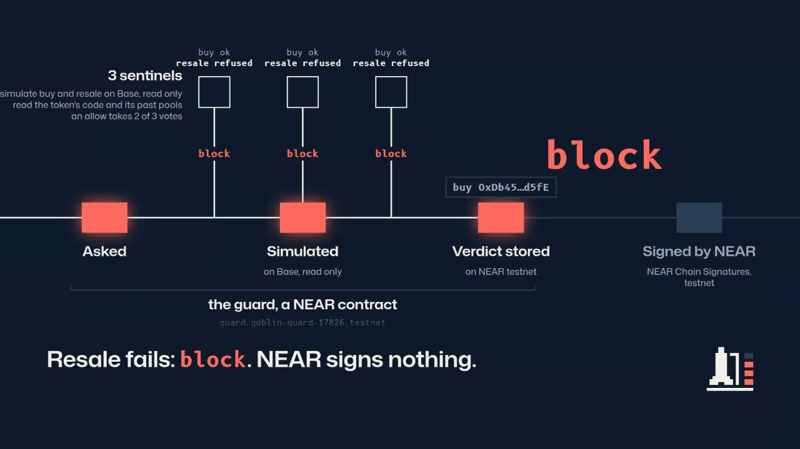

<p align="center">
  
</p>

# near-preflight

[](https://github.com/cmoron/near-preflight/actions/workflows/ci.yml)
[](LICENSE)
[](https://cmoron.github.io/near-preflight/)

**Test the resale before the buy. NEAR signs only what was checked.**

<p align="center">
  <a href="https://cmoron.github.io/near-preflight/#demo"></a>
</p>

**[▶ Watch the demo](https://cmoron.github.io/near-preflight/#demo)** (86 s, no sound) · **[Give this to your agent](#give-this-to-your-agent)** · **[Verify in one minute](#in-one-minute-nothing-to-install)** · **[Verify it yourself](#verify-it-yourself)**
<!-- X-POST: when the demo post exists, replace this whole comment with:  · **[Demo post on X](https://x.com/…)** -->

A spending cap stops an AI agent from spending too much. It does not stop a prompt-injected agent from spending a little on a scam token.

**1. The token is checked first.** Before any purchase, three checkers (the _sentinels_) simulate the buy and then the resale on Base, and look up whether earlier pools of the same token code were drained. They vote `allow`, `warn` or `block`. Anyone can replay a vote.

**2. The agent cannot skip the check.** It holds no key for Base, the chain it buys on. A NEAR contract (the _guard_) builds the swap itself, and NEAR Chain Signatures signs it only after two of the three sentinels said `allow`, or the owner approved their `warn`. The agent picks a token and an amount, nothing else.

**See it for yourself**

- Run `./verify.sh`: it reads the three deployed guards from public NEAR nodes, and four receipts from Base Sepolia, with `curl` and `jq`. No account, no key, 7 s here ([its output](#in-one-minute-nothing-to-install)).
- Four transactions NEAR signed, mined on Base Sepolia: the [buy](https://sepolia.basescan.org/tx/0x2d5d377655b8f8faf7921b40e2a25cfe95190c1b8a17e6d0733f4b1070e46863), the sale ([approve](https://sepolia.basescan.org/tx/0xd7de762732c130366e39ca543ebfeb8ad0fb9708d8cec0604e24f9403d14c4c4), then [swap](https://sepolia.basescan.org/tx/0x7f65205ca9c33b80a9228b0ed2c0647c75548fb6aa2e780020355cc4778a21c9)) and the owner's [withdrawal](https://sepolia.basescan.org/tx/0x30d09618730ad7d4500318ed82ab55dfc99dc42d7ac5ef8509adf0d859a80943).
- The guard that had them signed, [`guard.preflight-sepolia-96623.testnet`](https://testnet.nearblocks.io/address/guard.preflight-sepolia-96623.testnet): its account holds no access key.

It is for the operator of an agent or bot that buys newly launched tokens on Uniswap V2 on Base, who can wait tens of seconds and wants a refusal that states its reason and can be replayed.

Scope today: Uniswap V2 token/WETH pools on Base, NEAR testnet. The demo's purchases execute on a local copy of Base. A second guard's buy, sale and withdrawal were mined on Base Sepolia, with test tokens we deployed ([Base Sepolia](docs/base-sepolia.md)). The three sentinels run on one machine.

The same contract is also on NEAR mainnet as [`guard.near-preflight.near`](https://nearblocks.io/address/guard.near-preflight.near), inert: no agent, bounds at zero, nothing signed. Its code hash is the reproducible build of the demo guard ([mainnet](docs/mainnet.md)).

## Give this to your agent

Paste this to your coding agent (Claude Code, Codex…): it sets up your own guard with you and makes an agent buy through it.

```text
Read https://raw.githubusercontent.com/cmoron/near-preflight/main/docs/agent-guide.md and guide me through it step by step. Ask me before anything that creates an account, signs or spends.
```

It costs about 8 testnet NEAR from the faucet, no real funds; it needs `bun`, Foundry, `jq`, Rust and the `near` CLI, and its smoke test runs 7 min.

## One purchase

<p align="center"></p>

1. **Asked.** The AI agent asks the guard to check a token and an amount. It is untrusted: a prompt injection may be steering it.
2. **Simulated.** Each sentinel reads the request and simulates on Base the buy the guard would sign, then the resale.
3. **Verdict stored.** Each sentinel votes `allow`, `warn` or `block`, with the sha256 of its evidence. Two matching votes make an `allow` or a `warn`; a single `block` refuses.
4. **Signed by NEAR.** On `allow`, the agent asks to buy. The guard builds exactly the swap that was simulated, and Chain Signatures signs it.

Anyone can then broadcast the signed swap, no key needed; the code calls that broadcaster the **relay**. In the demo it goes to a local fork of Base; the Base Sepolia guard's swaps went to Base Sepolia. The relay refuses every other chain.

The guard's owner appoints the sentinels, which are off-chain programs. Anyone can [replay](docs/replay.md) a verdict, and the [threat model](docs/threat-model.md#a-lying-sentinel) says what a lying sentinel can still do.

## How NEAR is used

- **A contract, the guard.** It holds each agent's budget, the owner's rules and every verdict, and builds each Base transaction ([contract](docs/contract.md)).
- **Chain Signatures.** NEAR's threshold signing network signs for the guard's Base address. The agent, the sentinels and the armer hold no Base key and no key that can make NEAR sign. The guard account's own full-access key, held by the owner, can: a production guard deletes it or locks it ([upgrade policy](docs/contract.md#upgrade-policy)). The Base Sepolia guard's was deleted: its account holds no key, and after that it still refused a trap token and signed its owner's withdrawal ([Base Sepolia](docs/base-sepolia.md)).
- **Function-call keys.** The agent, the armer (who opens the agent's budget) and each sentinel hold a key limited to their own methods of the guard ([roles](docs/contract.md#roles-and-keys)).
- **NEAR AI Cloud.** The demo agent's model runs in an attested enclave (TEE) that signs its decision; `app/attest.ts` verifies it ([attest](docs/replay.md#the-attested-agent)). The guard does not rely on it.

## Why

- **The traps are real.** On Base on 2026-11-11, 24 of the 29 token/WETH pools opened on Uniswap V2 in 2.4 h were drained a median 13 min after funding; all 29 tokens shared one code template ([measurement](docs/sentinel.md#measured-on-real-base)).
- **Measured on 96 real Base launches.** 81 ended badly within 24 h. 73 were blocked before the buy (one scam farm, recognised by its code's history); the other 8 got `warn`. None got `allow`. Of the 11 that survived, 8 got `warn` and 3 `block`; the last 4, of unclear outcome, got `block` ([corpus](docs/corpus.md)).
- **What that shows.** It stops repeat farms and traps written in a token's code (the latter shown on our own trap tokens). It does not tell an honest new launch from one whose liquidity will be pulled: both get `warn`, and the owner decides.
- **What a fresh launch gets.** A pool under an hour old whose liquidity is not burned gets `warn` at best, which the owner approves or not within 120 s of the verdict. `allow` is for tokens with history, such as USDC.

## Verify it yourself

### In one minute, nothing to install

`./verify.sh` reads the three deployed guards from public NEAR nodes, and four receipts from Base Sepolia, with `curl` and `jq`: no account, no key, no `bun`. It took 7 s here. CI runs it on every push to `main` and once a day ([workflow](.github/workflows/ci.yml)).

```text
$ ./verify.sh
NEAR testnet, the demo guard (https://test.rpc.fastnear.com)
PASS  guard.goblin-guard-17826.testnet: code sha256 3c5b992fea5d6e13cbf6c75760d138fa434a1efd67d5a1ff385f9bacb566372f, the reproducible build's
PASS  guard.goblin-guard-17826.testnet: source metadata (NEP-330) names commit 22e5c32ad5387189eee7575ce00c6938ff253dc2
PASS  sentinels: sentinel, sentinel2, sentinel3, quorum 2
PASS  signer: v1.signer-prod.testnet (NEAR Chain Signatures on testnet), for the Base address 0x32fA09D7725D86CaF6A69e0Aa7819bad1b8127C9
PASS  checks stored: 27, verdicts allow 12, warn 2, block 13, none yet 0
PASS  buys NEAR signed: 10, each on 2 matching sentinel votes: allow 9, warn approved by the owner 1
PASS  no buy signed on a block (9 checks) or on a warn not approved (1)
PASS  agent.goblin-guard-17826.testnet: 1 function-call key, limited to the guard and to buy, refund_check, request_check, request_exit, sell_quoted
INFO  agent.goblin-guard-17826.testnet also has 1 full-access key: setup keeps it in the owner's keychain, the agent process gets the function-call key. Not provable on chain.
INFO  guard.goblin-guard-17826.testnet holds 1 full-access key: its holder can redeploy it (README, How NEAR is used).

NEAR testnet, the keyless Base Sepolia guard (https://test.rpc.fastnear.com)
PASS  guard.preflight-sepolia-96623.testnet: code sha256 f2136c17d830afc5123e9ee80b5b6bc2aa857d6d571c6e1bb7e6c80faef301a9, the reproducible build's
PASS  guard.preflight-sepolia-96623.testnet: source metadata (NEP-330) names commit c3c361fdba68d7ce03b4c94ded5aca71cb761755
PASS  guard.preflight-sepolia-96623.testnet: access keys []: no key can redeploy it, move its NEAR or call the signer as the guard
PASS  sentinels: sentinel, sentinel2, sentinel3, quorum 2
PASS  chain id fixed at init: 84532 (Base Sepolia); signer v1.signer-prod.testnet, for the address 0x4F87638FB3F58aE20630369eb2e02D6F0C68Ba5E
PASS  checks stored: 4, verdicts allow 2, warn 0, block 2, none yet 0
PASS  buys NEAR signed: 1, each on 2 matching sentinel votes: allow 1, warn approved by the owner 0
PASS  no buy signed on a block (2 checks) or on a warn not approved (0)
PASS  Base Sepolia, buy 0x2d5d377655b8f8faf7921b40e2a25cfe95190c1b8a17e6d0733f4b1070e46863: status 0x1, sent by the guard's address
PASS  Base Sepolia, sale-approve 0xd7de762732c130366e39ca543ebfeb8ad0fb9708d8cec0604e24f9403d14c4c4: status 0x1, sent by the guard's address
PASS  Base Sepolia, sale-swap 0x7f65205ca9c33b80a9228b0ed2c0647c75548fb6aa2e780020355cc4778a21c9: status 0x1, sent by the guard's address
PASS  Base Sepolia, withdrawal 0x30d09618730ad7d4500318ed82ab55dfc99dc42d7ac5ef8509adf0d859a80943: status 0x1, sent by the guard's address
INFO  Both tokens on Base Sepolia are test tokens we deployed; the three sentinels ran on one machine (docs/base-sepolia.md#limits).

NEAR mainnet, the inert guard (https://free.rpc.fastnear.com)
PASS  guard.near-preflight.near: code sha256 3c5b992fea5d6e13cbf6c75760d138fa434a1efd67d5a1ff385f9bacb566372f, the reproducible build's
PASS  guard.near-preflight.near: source metadata (NEP-330) names commit 22e5c32ad5387189eee7575ce00c6938ff253dc2
PASS  only sentinel: near-preflight.near, the guard's parent account, quorum 1
PASS  bounds and per-token cap zero (max_buy_wei 0, cap_wei 0): every check is refused
PASS  agents registered: 0
PASS  checks requested: 0; exits or withdrawals signed: none
PASS  signer: v1.signer (NEAR Chain Signatures on mainnet)
PASS  its Base address 0xB407022A1e227D66B994149d25c675d4cdbc9538 holds 0x0 wei on Base mainnet (https://mainnet.base.org)
PASS  guard.near-preflight.near: 0 function-call key: no agent, armer or sentinel key can act on it
INFO  guard.near-preflight.near holds 1 full-access key, the owner's: inert until the owner changes it, not immutable (docs/mainnet.md).

ALL CHECKS PASSED
```

`INFO` lines are disclosures, not claims. Not checked here, because it takes more than `curl`: the inert guard's owner and armer, and that each Base address is the one the signer derives (`bun app/deploy.ts near-preflight.near --verify` reads both, see [mainnet](docs/mainnet.md#verify)).

### The three deployed guards

Three guards are deployed, on two versions of the contract:

| Guard | Network | Role | Code commit | Wasm sha256 | Access keys of the guard account |
| --- | --- | --- | --- | --- | --- |
| `guard.goblin-guard-17826.testnet` | NEAR testnet | the demo: signs for Base (chain 8453), swaps go to a local fork | `22e5c32` | `3c5b992f…372f` | one full-access key, the owner's |
| `guard.near-preflight.near` | NEAR mainnet | inert: no agent, bounds at zero, nothing signed | `22e5c32` | `3c5b992f…372f` | one full-access key, the owner's |
| `guard.preflight-sepolia-96623.testnet` | NEAR testnet | signs for Base Sepolia (chain 84532): a buy, a sale and a withdrawal mined | `c3c361f` (tag `base-sepolia-guard`) | `f2136c17…01a9` | none |

Commit `c3c361f` adds one thing to the contract: the EVM chain is fixed at init, 8453 or 84532. `./verify.sh` reads the commit, the hash and the keys of each from public nodes.

### Claims and where to check them

Code is `src/lib.rs` unless a file is named; Rust tests are in `src/tests/`. Check numbers are the demo guard's: `get_check {"id": n}` on `guard.goblin-guard-17826.testnet`, or the [status page](https://cmoron.github.io/near-preflight/journal.html). The last two rows are the Base Sepolia guard's ([its transactions](docs/base-sepolia.md#what-happened)).

| Claim | Code | Test | On chain |
| --- | --- | --- | --- |
| The agent holds no Base key | `buy` (l. 1688) takes a check id and an amount; `app/demo.ts` gives the agent process `.env.agent` only | `app/relay.test.ts`: "refused: other router, other token, other recipient, other signer, other chain" | the agent's key list: one function-call key, five methods of the guard (`verify.sh`). Its off-chain keys cannot be read on chain |
| The guard builds the swap | `preview_check` (l. 2225), `buy` | `buy.rs`: `the_preview_is_the_transaction_the_buy_signs` | check #27: `tx_hashes` voted by the sentinels, then `signed_tx` |
| NEAR signs only after two of three said `allow` | `post_verdict` (l. 1311), `buy` | `checks.rs`: `one_allow_vote_of_two_does_not_buy`, `two_identical_allow_votes_make_the_verdict` | the 10 signed buys and their votes (`verify.sh`); check #27: `allow` from `sentinel` and `sentinel3` |
| A `warn` buys only once the owner approved it | `approve_warn` (l. 2127) | `buy.rs`: `buy_refused_on_warn_without_the_human`, `an_approved_warn_is_bought_and_the_approval_is_logged` | check #6: `warn`, not approved, nothing signed; check #7: same token, `approved`, signed |
| A `block` quarantines the token for every agent | `post_verdict`, `request_check` (l. 1147) | `quarantine.rs`: `a_blocked_token_is_not_checked_again_at_once`, `another_agent_does_not_check_a_blocked_token_either` | `token_limits`: `quarantine_s` 1800; check #25, a `block`. A quarantine lapses after 30 min: `quarantined_until` shows only a current one |
| Anyone can replay a verdict | `app/replay.ts` | `app/replay.test.ts`: "a tampered verdict (block -> allow) is detected" | check #19: `evidence_sha256` `df51fe65…f3b8`, the sha256 of the evidence in `app/fixtures/usdc-base-mainnet.json` |
| An exit sells on the sentinels' quote | `request_exit` (l. 1192), `sell_quoted` (l. 1844) | `exits.rs`: `an_exit_floor_is_the_median_of_three_quotes` | check #5: an exit, three votes carrying the same quote |
| The mainnet guard is inert | `verify()` in `app/deploy.ts` | `app/deploy.test.ts`: "the inert guard: one account, its code and new, every role the owner's, nothing else" | `guard.near-preflight.near`: transactions [1](https://nearblocks.io/txns/F3AabD7DJf7XQCSwFA3BuJG3JKuPzjrYoegTN6aR9VJf) and [2](https://nearblocks.io/txns/E35MNZ1KdKvvVCmWxYshP52snsrsNBeXxetKTqGNkzgo), views `bounds`, `sentinels`, `last_check_id` (`verify.sh`) |
| A signed swap lands on a public chain | `new` (l. 657) fixes `evm.chain_id`, `router_of` (l. 227) names its router; `nodeKind` in `app/relay.ts` | `buy.rs`: `a_base_sepolia_guard_signs_for_chain_84532_on_its_own_router`; `app/relay.test.ts`: "a transaction signed for Base Sepolia is broadcast to Base Sepolia as it is, with no fork setup" | `guard.preflight-sepolia-96623.testnet`, check #1: buy [`0x2d5d3776…`](https://sepolia.basescan.org/tx/0x2d5d377655b8f8faf7921b40e2a25cfe95190c1b8a17e6d0733f4b1070e46863); its sale, check #2: approve [`0xd7de7627…`](https://sepolia.basescan.org/tx/0xd7de762732c130366e39ca543ebfeb8ad0fb9708d8cec0604e24f9403d14c4c4), swap [`0x7f65205c…`](https://sepolia.basescan.org/tx/0x7f65205ca9c33b80a9228b0ed2c0647c75548fb6aa2e780020355cc4778a21c9). Each receipt: status 1, sent by the guard's address (`verify.sh`) |
| A guard with no access key still enforces the rules | `app/lock.ts` deletes the key; the rules are `post_verdict`, `buy`, `withdraw_eth` (l. 1905) | none for `app/lock.ts`; the rules have the tests of the rows above | `guard.preflight-sepolia-96623.testnet`: key list `[]` (`verify.sh`), deleted in [`2JpL71bh…`](https://testnet.nearblocks.io/txns/2JpL71bhLXDs585nmY1pX3nPFL4Srouw3Jwv2HJAS3Mp). After it: checks #3 and #4, `block`, nothing signed; the owner's withdrawal [`0x30d09618…`](https://sepolia.basescan.org/tx/0x30d09618730ad7d4500318ed82ab55dfc99dc42d7ac5ef8509adf0d859a80943), status 1 |

### Replay a verdict, run the traps

No NEAR account, no key, nothing to deploy. You need `bun` 1.4, Foundry 1.8 and `jq`.

The first three commands take under two minutes: `replay` starts its own throwaway forks (local copies of Base, run by Foundry's anvil). The trap tests take six more, on a fork you start.

First, the [status page](https://cmoron.github.io/near-preflight/journal.html) lists every check of the demo guard and its verdict.

<a href="https://cmoron.github.io/near-preflight/journal.html"></a>

```sh
git clone https://github.com/cmoron/near-preflight && cd near-preflight && bun install
export GUARD=guard.goblin-guard-17826.testnet   # the demo guard on NEAR testnet, read only

# Replay check #19 (USDC on Base mainnet) and compare the result with the verdict stored on NEAR
INDEX_RPC=https://base-rpc.publicnode.com bun app/replay.ts app/fixtures/usdc-base-mainnet.json https://mainnet.base.org --check
#   REPLAY OK: verdict allow confirmed, same as on chain

# Replay check #1 of the Base Sepolia guard, the buy that was mined, against the verdict stored on NEAR
GUARD=guard.preflight-sepolia-96623.testnet EVM_CHAIN_ID=84532 INDEX_RPC=https://base-sepolia-rpc.publicnode.com bun app/replay.ts app/fixtures/base-sepolia-buy.json https://sepolia.base.org --check
#   REPLAY OK: verdict allow confirmed, same as on chain

# The model's decision behind check #10: signature, Intel and NVIDIA attestation, the guard's record
bun app/attest.ts app/fixtures/decision.json --check 10
#   ATTEST OK: 15 checks hold (1 not verified, see SKIPPED)

# Every trap of the table below, as CI runs it
[ -f .env ] || echo GUARD=$GUARD > .env
evm/fork.sh                  # terminal 1: wait for "Base fork at block … ready" (about 30 s), leave it running
bun test --timeout 30000     # terminal 2: 371 pass, 0 fail (5 to 7 min)
```

`INDEX_RPC` serves the logs the template index is rebuilt from; `mainnet.base.org` refuses them. When no anvil is running, `evm/fork.sh` first deletes the state directories stopped anvils left in `~/.foundry/anvil/tmp` (10 GB and more each).

These commands read public Base nodes. If one answers `429`, wait a minute and run the command again; `FORK_URL=<a Base archive node> evm/fork.sh` starts the fork from another node.

## What it stops

| Attack                                                                                  | Verdict                                   | Details                                                          |
| --------------------------------------------------------------------------------------- | ----------------------------------------- | ---------------------------------------------------------------- |
| A token you can buy but never sell                                                      | 🔴 block, listed                          | [honeypot](docs/threat-model.md#sale-refused-after-the-buy)      |
| The token's owner takes tokens back without approval                                    | 🔴 block, listed                          | [takeback](docs/threat-model.md#the-owner-takes-tokens-back)     |
| A clean copy of code whose earlier pools were drained                                   | 🔴 block                                  | [farm](docs/threat-model.md#template-farm)                       |
| A token that sells only in a simulation, or only at the sizes and delays a check tries  | 🔴 block, listed                          | [tells](docs/threat-model.md#telling-the-check-from-a-real-sale) |
| A token keyed on what Base changes between the buy and the sale: WETH, the factory, the base fee… | 🔴 block; 🟠 warn while a fee value it reads has not moved | [state](docs/threat-model.md#state-base-moves-every-block), [values](docs/threat-model.md#values-no-simulation-can-match) |
| A token whose own code reads the time or its pool, to change after the check            | 🟠 warn, the owner decides                | [own code](docs/threat-model.md#what-the-tokens-own-code-did)    |
| A prompt-injected agent changes the route, recipient or minimum output                  | 🔴 ignored: NEAR signs what was simulated | [bypasses](docs/threat-model.md#agent-bypasses)                  |
| One stolen sentinel key, or a Base node only one sentinel reads, says `allow` on a trap | 🔴 no allow: it takes two of the three    | [quorum](docs/threat-model.md#a-lying-sentinel)                  |
| An honest token: USDC on the fork, or read only on Base mainnet                         | 🟢 allow; on the fork NEAR signs the swap | [honest](docs/threat-model.md#honest-tokens)                     |

**Listed**: put on the guard's shared blocklist, refused to every agent. Each link gives the exact reason and the test that shows it.

## What it does not stop

- **Two of the three sentinels lying.** One alone never allows: it can block a buy, or [spoil an exit](docs/threat-model.md#a-lying-sentinel) while another is down. In the demo all three run on one machine: three keys, not three parties. Replay shows a lie afterwards.
- **A rug by liquidity removal.** A token that sells normally gets `warn` (removable liquidity) at best, and `block` only when its code template has drained pools before.
- **Same-second entries.** A verdict takes about 30 s on Base, 20 s of them a deliberate wait for a later block; NEAR's signature takes 6 s more ([latency](docs/latency.md)).
- **Other pools.** Only Uniswap V2 WETH pools on Base are checked and bought today.
- **Execution on Base mainnet.** There it gives verdicts, read only. A buy of a Base mainnet token runs on a local fork. The swaps mined on Base Sepolia bought and sold test tokens we deployed ourselves.

> [!WARNING]
> Never send funds to the guard's address on Base mainnet. A transaction NEAR signs for chain 8453 is valid there. The relay broadcasts only to a local fork, or to Base Sepolia a transaction signed for Base Sepolia; it refuses every other chain.

Every limit, with its reason: [threat model](docs/threat-model.md#what-it-does-not-stop).

## Run the full demo

<details>
<summary>Eight steps with a NEAR testnet account</summary>

1. Install Rust with `cargo-near` 0.23, `near` CLI 0.31, `bun` 1.4, Foundry 1.8 and `jq`. `cargo test` gives `358 passed`; then `bun install`.
2. Get a testnet account holding about 8 NEAR. The faucet gives 10; if it answers `429`, see [troubleshooting](docs/reproduce.md#troubleshooting).
3. `cargo near build non-reproducible-wasm && bun app/setup.ts <you>.testnet` deploys the guard and creates the agent, armer and three sentinel accounts, each with a key limited to the guard.
4. `evm/fork.sh` in another terminal, then `bun test --timeout 30000`: `371 pass`.
5. `./demo.sh` exits 0 in about 7 min: a poisoned message pushes the agent to a trap (blocked), a farm copy (blocked), USDC (allowed, signed by NEAR, broadcast to the fork), then the agent's bypasses (refused).
6. It prints this run's `replay --check` and `attest --check` commands; each exits 0.
7. Optional: `NEAR_AI_API_KEY` in `.env.llm` runs the live model; `./demo.sh --full` adds an exit, an approved `warn`, a second agent and the emergency stop.
8. `./check-mainnet.sh` exits 0 in a minute and a half: USDC simulated on Base mainnet by each sentinel on its own nodes, read only, `allow`, then replayed; nothing is signed.

Expected output of each step and the deployment facts: [reproduce](docs/reproduce.md).

</details>

## Documentation

The [docs index](docs/README.md): architecture, threat model, contract, sentinel, replay, reproduction, glossary.

## Next

- Execution on Base mainnet: today verdicts only there, mined swaps only on Base Sepolia.
- Uniswap V3 and V4 pools.
- Sentinels run by separate parties, each on its own machine.

## Disclosure

Written from 2026-11-11 for the NEAR Hackathon, tracks AI Security & Defense and Open Innovation, in a new repository.

The team is one human and AI coding agents (Claude Code): the code and the docs were written with them.

The team has run trading agents with real money on an EVM chain; the traps and the template-reputation method come from those losses. No code, strategy, wallet, address list or account from that work is reused or published.

Libraries: near-sdk, omni-transaction (Rust), near-api-js, viem, @phala/dcap-qvl-node (TypeScript), Foundry. Agent model: `z-ai/glm-5.3-flash` on NEAR AI Cloud.

License: MIT.
