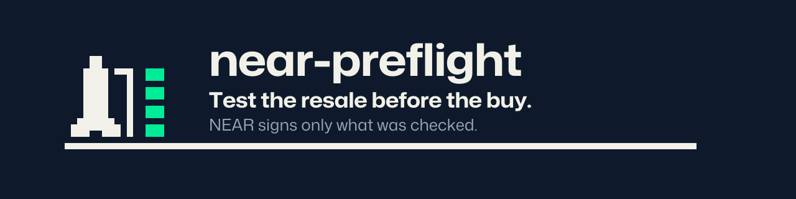
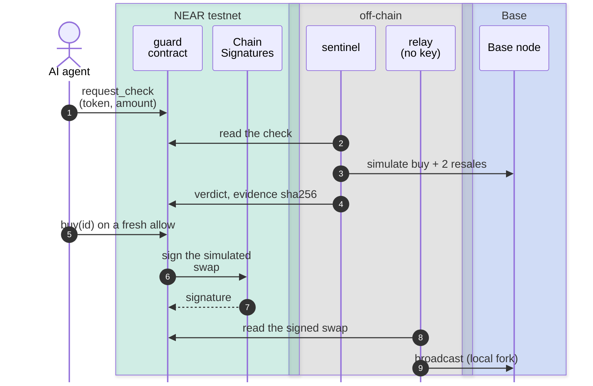
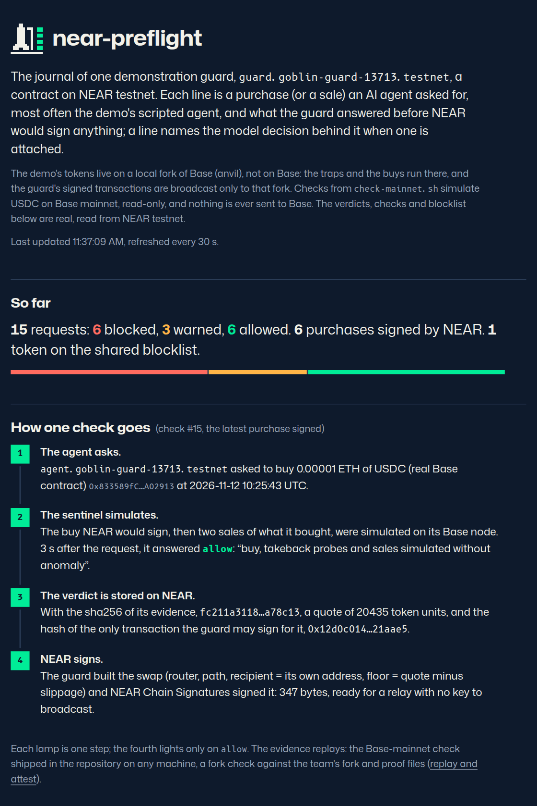

<p align="center">
  
</p>

# near-preflight

[](https://github.com/cmoron/near-preflight/actions/workflows/ci.yml)
[](LICENSE)
[](https://cmoron.github.io/near-preflight/)

**An AI agent cannot buy a token it could never sell.**

A spending cap stops an agent from spending too much. It does not stop a prompt-injected agent from spending a little on a trap.

Before NEAR signs any purchase, near-preflight simulates the buy and the resale, checks whether the token's code has drained pools before, and stores a verdict anyone can replay.

The agent holds no key for Base, the chain it buys on: the contract builds the transaction and NEAR signs it.

## One purchase



The **guard** is the NEAR contract. **Chain Signatures**, NEAR's threshold signing network, signs for the guard's Base address. The **relay** only broadcasts.

The **sentinel** is an off-chain program the guard's owner appoints: its NEAR key can only post verdicts.

Do not trust it blindly: anyone can [replay](docs/replay.md) a verdict, and the [threat model](docs/threat-model.md#a-lying-sentinel) says what a lying sentinel can still do.

## Why

- **A cap does not judge the token.** It bounds how much an agent spends, not on what; an allowlist judges only tokens someone already listed.
- **The traps are real.** On Base on 2026-11-11, 24 of the 29 new token/WETH pools on Uniswap V2 were drained a median 2.2 h after funding; all 29 tokens shared one code template ([measurement](docs/sentinel.md#measured-on-real-base)).
- **Every step can be checked.** NEAR signs only the transaction the sentinel simulated, the agent never picks route, recipient or minimum output, and anyone can re-derive a verdict.

## Verify it yourself in five minutes

No NEAR account, no key. You need `bun` 1.4, Foundry 1.8 and `jq`; a **fork** below is a local copy of Base run by Foundry's anvil.

First, the [status page](https://cmoron.github.io/near-preflight/) lists every check of the demo guard and its verdict.

<a href="https://cmoron.github.io/near-preflight/"></a>

```sh
git clone https://github.com/cmoron/near-preflight && cd near-preflight && bun install
export GUARD=guard.goblin-guard-13713.testnet   # the demo guard on NEAR testnet, read only

# Check #5 (USDC on Base mainnet): resent, traced on a local fork, re-judged, compared with NEAR
bun app/replay.ts app/fixtures/usdc-base-mainnet.json https://mainnet.base.org --check
#   REPLAY OK: verdict warn confirmed, same as on chain

# The model's decision behind check #1: signature, Intel and NVIDIA attestation, the guard's record
bun app/attest.ts app/fixtures/decision.json --check 1
#   ATTEST OK: 15 checks hold (1 not verified, see SKIPPED)

# Every trap below, on a local Base fork, as CI runs it (about 1 min, then 2.5 min)
echo GUARD=$GUARD > .env && evm/fork.sh   # then, in another terminal:
bun test --timeout 30000                  #   260 pass, 0 fail
```

USDC gets `warn` on mainnet only because no template index covers mainnet: an unknown reputation is never a pass.

## What it stops

| Attack                                                                     | Verdict                                   | Details                                                          |
| -------------------------------------------------------------------------- | ----------------------------------------- | ---------------------------------------------------------------- |
| A token you can buy but never sell                                         | 🔴 block, listed                          | [honeypot](docs/threat-model.md#sale-refused-after-the-buy)      |
| The token's owner takes tokens back without approval                       | 🔴 block, listed                          | [takeback](docs/threat-model.md#the-owner-takes-tokens-back)     |
| A clean copy of code whose earlier pools were drained                      | 🔴 block                                  | [farm](docs/threat-model.md#template-farm)                       |
| A token that sells only in a simulation, or at the delay a check would try | 🔴 block, listed                          | [tells](docs/threat-model.md#telling-the-check-from-a-real-sale) |
| A token that sells only while Base's own state stands still                | 🔴 block                                  | [state](docs/threat-model.md#state-base-moves-every-block)       |
| Code that reads values no simulation can match (base fee, coinbase…)       | 🟠 warn, the owner decides                | [opcodes](docs/threat-model.md#values-no-simulation-can-match)   |
| A prompt-injected agent changes the route, recipient or minimum output     | 🔴 ignored: NEAR signs what was simulated | [bypasses](docs/threat-model.md#agent-bypasses)                  |
| An honest token (USDC on the fork)                                         | 🟢 allow, NEAR signs the swap             | [honest](docs/threat-model.md#honest-tokens)                     |

**Listed**: put on the guard's shared blocklist, refused to every agent. Each link gives the exact reason and the test that shows it.

## What it does not stop

- **A lying sentinel.** Its `allow` on a trap can be bought within 120 s; replay shows the lie only afterwards.
- **What a token does later.** A pause, tax or blacklist after the buy; a change after the check's last simulated sale.
- **Front-running.** The signing request is public on NEAR before the swap reaches Base.
- **Template evasion.** Changing the code makes a new template; fewer than 3 earlier pools give no finding.

> [!WARNING]
> Never send funds to the guard's address on Base mainnet. A transaction NEAR signs for chain 8453 is valid there; this demo broadcasts only to a local fork.

Every limit, with its reason: [threat model](docs/threat-model.md#what-it-does-not-stop).

## Run the full demo

<details>
<summary>Eight steps with a NEAR testnet account</summary>

1. Install Rust with `cargo-near` 0.23, `near` CLI 0.31, `bun` 1.4, Foundry 1.8 and `jq`. `cargo test` gives `247 passed`; then `bun install`.
2. Get a testnet account holding about 7 NEAR. The faucet gives 10; if it answers `429`, see [troubleshooting](docs/reproduce.md#troubleshooting).
3. `cargo near build non-reproducible-wasm && bun app/setup.ts <you>.testnet` deploys the guard and creates the agent, sentinel and armer accounts, each with a key limited to the guard.
4. `evm/fork.sh` in another terminal, then `bun test --timeout 30000`: `260 pass`.
5. `./demo.sh` exits 0 in 1 to 2 min: a poisoned message pushes the agent to a trap (blocked), a farm copy (blocked), USDC (allowed, signed by NEAR, broadcast to the fork), then the agent's bypasses (refused).
6. It prints this run's `replay --check` and `attest --check` commands; each exits 0.
7. Optional: `NEAR_AI_API_KEY` in `.env.llm` runs the live model; `./demo.sh --full` adds an exit, an approved `warn`, a second agent and the emergency stop.
8. `./check-mainnet.sh` exits 0: USDC simulated on Base mainnet, read only, then replayed.

Expected output of each step and the deployment facts: [reproduce](docs/reproduce.md).

</details>

## Documentation

The [docs index](docs/README.md): architecture, threat model, contract, sentinel, replay, reproduction, glossary.

## Disclosure

Written from 2026-11-11 for the NEAR Hackathon, track AI Security & Defense, in a new repository.

Our team has run trading agents with real money on an EVM chain; the traps and the template-reputation method come from those losses. No code, strategy, wallet, address list or account from that work is reused or published.

Libraries: near-sdk, omni-transaction (Rust), near-api-js, viem, @phala/dcap-qvl-node (TypeScript), Foundry. Agent model: `z-ai/glm-5.3-flash` on NEAR AI Cloud.

Code written with AI assistance (Claude Code). License: MIT.
