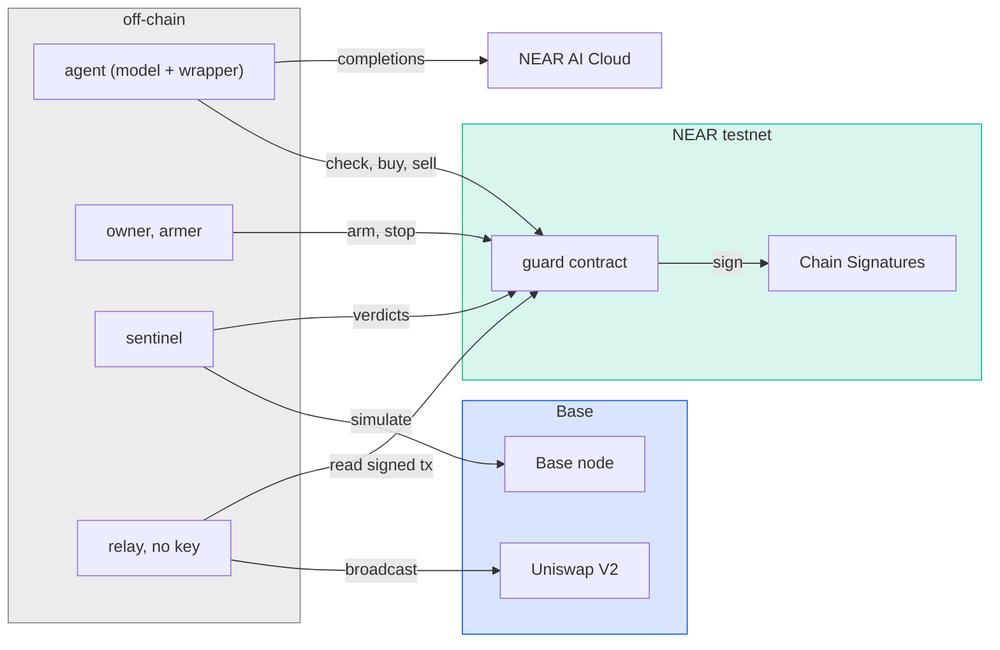
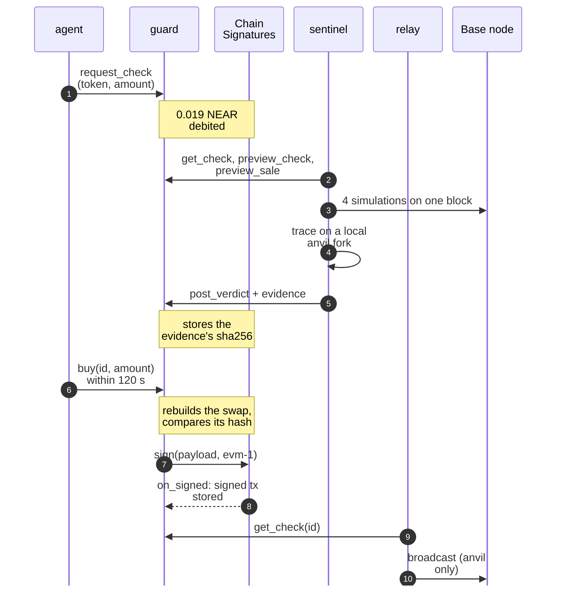
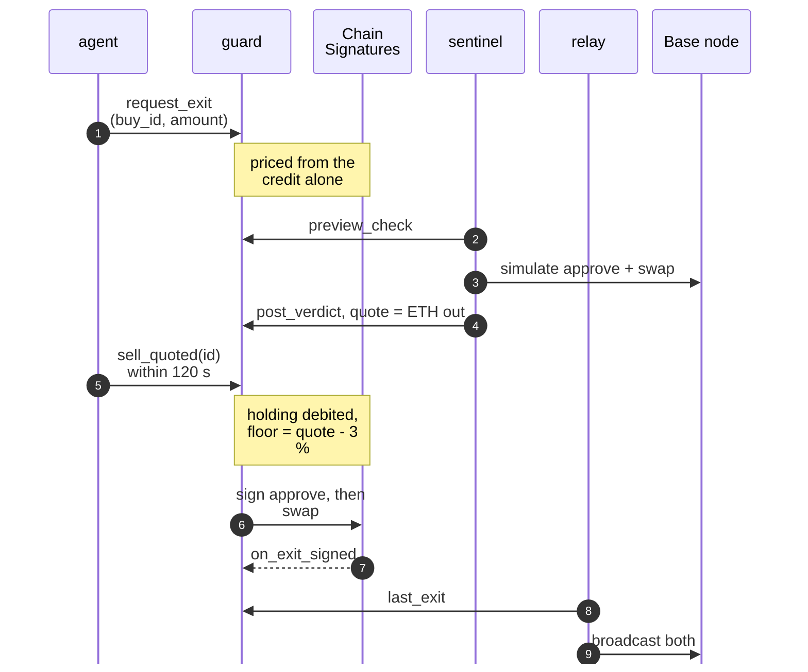

# Architecture

One contract on NEAR, a few programs off-chain, and Base, where the tokens trade. This page shows who
talks to whom, what each key can do, where state lives, and which file implements what.

## Contents

- [Components](#components)
- [One buy](#one-buy)
- [One exit](#one-exit)
- [Trust boundaries](#trust-boundaries)
- [Where state lives](#where-state-lives)
- [Source map](#source-map)

## Components

| Component            | Runs                                       | Does                                                                                 |
| -------------------- | ------------------------------------------ | ------------------------------------------------------------------------------------ |
| **guard**            | NEAR contract                              | holds credits and budgets, stores checks and verdicts, builds every Base transaction |
| **Chain Signatures** | NEAR's threshold signing network (the MPC) | signs for the guard's derived Base address whatever the guard asks                   |
| **sentinel**         | off-chain, one machine                     | simulates each check on a Base node, posts the verdict and its evidence's sha256     |
| **agent**            | off-chain                                  | the model decides; its wrapper calls the guard with the agent's key                  |
| **armer**            | off-chain                                  | opens the agent's armed budget within the owner's bounds                             |
| **owner**            | a human                                    | sets bounds and roles, stops, approves a `warn`, recovers                            |
| **relay**            | anywhere, no key                           | reads a signed transaction from the guard, checks it, broadcasts it                  |
| **replay, attest**   | anyone                                     | re-derive a verdict, verify a model decision ([replay](replay.md))                   |

## One buy

The sentinel polls the guard (`last_check_id`, then `get_check`): the guard never calls out. A `block`
posted with `list_target` also lists the token. The four requests are in [sentinel](sentinel.md#the-four-requests).

## One exit

If the swap reverts on Base, the holding stays debited until the owner restores it
([recovery](contract.md#recovery)). The owner can always sell with `sell`, which needs no quote.

## Trust boundaries

| Key                           | Held by                      | Can                                                                                                         | Cannot                                                                                        |
| ----------------------------- | ---------------------------- | ----------------------------------------------------------------------------------------------------------- | --------------------------------------------------------------------------------------------- |
| Agent function-call key       | the agent's process          | the five agent methods, gas up to a 0.5 NEAR allowance                                                      | move NEAR, call the MPC, pick route, recipient or floor, buy without a fresh `allow`          |
| Sentinel function-call key    | the sentinel's machine       | post verdicts and exit quotes                                                                               | sign on Base, buy, move funds                                                                 |
| Armer function-call key       | the armer's process          | arm within the owner's bounds, disarm                                                                       | exceed the bounds; it can fill the 7-day cap (the owner resets)                               |
| Owner full-access key         | the human, near-cli keychain | every rule: bounds, roles, stop, approvals, unlist, sell, withdraw ETH to the address fixed at init, settle | change the code                                                                               |
| Guard account full-access key | the deployer's keychain      | deploy other code, move the guard's NEAR                                                                    | nothing is out of reach: production removes it ([upgrade policy](contract.md#upgrade-policy)) |
| Chain Signatures              | NEAR's MPC network           | sign for the guard's derived address, only when the guard calls it                                          | sign for that address at anyone else's request: the key derives from the caller's account     |
| none (relay)                  | anyone                       | broadcast a signed transaction, or not                                                                      | change it                                                                                     |

**Who is the sentinel, and why trust it?**

- It is an off-chain program the owner appoints with `set_sentinel`; in the demo, the owner runs it.
  One key on one machine, no TEE.
- You need not trust it to check it: [replay](replay.md) re-derives every verdict from its proof file
  and public chain data.
- Before anyone checks, a lying `allow` can buy a trap within 120 s ([threat model](threat-model.md#a-lying-sentinel)).
- The owner revokes it with `set_sentinel`. Running it in an enclave is the planned next step, not shipped.

**The model** holds no key. Its signed decision is optional evidence, not a gate
([attested agent](replay.md#the-attested-agent)).

## Where state lives

| Where               | What                                                                                                                                                                                         |
| ------------------- | -------------------------------------------------------------------------------------------------------------------------------------------------------------------------------------------- |
| NEAR, guard storage | checks (verdict, reasons, evidence sha256, quote, amount, tx hashes, `list_target`, signed tx), credits, budgets, arming log, blocklist, holdings, reserved nonces, code at the last verdict |
| NEAR, events        | every action, including the full evidence string in `verdict_posted`                                                                                                                         |
| Base                | the tokens and ETH at the guard's derived address, the pools                                                                                                                                 |
| Sentinel's machine  | `proofs/<id>.json` (requests and responses), the template index file (`INDEX`)                                                                                                               |
| Agent's machine     | decision packages in `proofs/llm/`                                                                                                                                                           |
| This repository     | two proofs in `app/fixtures/`, the fork's token addresses in `evm/tokens.json`                                                                                                               |

## Source map

| File                                                             | Implements                                                                            |
| ---------------------------------------------------------------- | ------------------------------------------------------------------------------------- |
| [`src/lib.rs`](../src/lib.rs)                                    | the guard contract and its unit tests ([contract](contract.md))                       |
| [`app/verifier.ts`](../app/verifier.ts)                          | the check: the four requests, judging, listing, exit quotes ([sentinel](sentinel.md)) |
| [`app/environment.ts`](../app/environment.ts)                    | the environment rule: addresses touched, opcodes                                      |
| [`app/index.ts`](../app/index.ts)                                | template index and reputation; CLI to build an index                                  |
| [`app/sentinel.ts`](../app/sentinel.ts)                          | the sentinel's loop: read checks, judge, post                                         |
| [`app/replay.ts`](../app/replay.ts)                              | replay of a proof ([replay](replay.md))                                               |
| [`app/attest.ts`](../app/attest.ts)                              | verification of a model decision                                                      |
| [`app/llm.ts`](../app/llm.ts)                                    | the model's tool loop on NEAR AI Cloud, decision packages                             |
| [`app/agent.ts`](../app/agent.ts)                                | the agent's wrapper: request a check, wait, buy, sell                                 |
| [`app/relay.ts`](../app/relay.ts)                                | the keyless relay, anvil only                                                         |
| [`app/arm.ts`](../app/arm.ts), [`app/human.ts`](../app/human.ts) | the armer's and the owner's CLIs                                                      |
| [`app/check.ts`](../app/check.ts)                                | one check from the command line                                                       |
| [`app/demo.ts`](../app/demo.ts), [`demo.sh`](../demo.sh)         | the demo                                                                              |
| [`check-mainnet.sh`](../check-mainnet.sh)                        | one check on Base mainnet, then its replay                                            |
| [`app/setup.ts`](../app/setup.ts)                                | deployment and role keys                                                              |
| [`app/derive.ts`](../app/derive.ts)                              | the guard's Base address, derived as Chain Signatures does                            |
| [`app/near.ts`](../app/near.ts)                                  | NEAR access shared by every role                                                      |
| [`app/testkit.ts`](../app/testkit.ts)                            | the guard's previews rebuilt in TypeScript for the fork tests                         |
| [`evm/fork.sh`](../evm/fork.sh), [`evm/src/`](../evm/src/)       | the local Base fork and its trap tokens                                               |
| [`docs/index.html`](index.html), [`docs/app.js`](app.js)         | the status page                                                                       |
| [`.github/workflows/ci.yml`](../.github/workflows/ci.yml)        | CI                                                                                    |

Each TypeScript module opens with a comment saying what it is for; each exported function says its
contract. Tests sit beside their module (`*.test.ts`).
